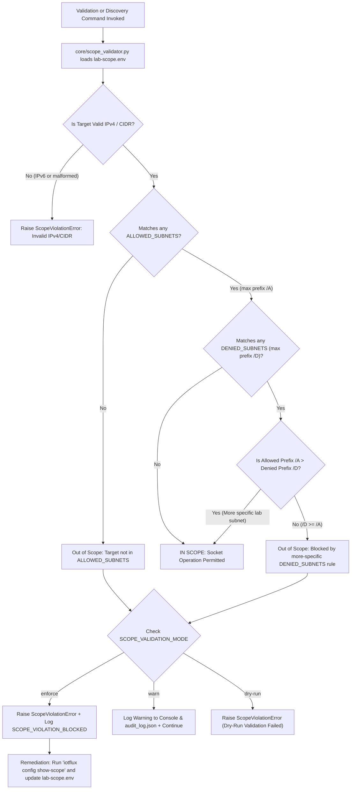

# IoTFlux Environment Adaptation & Operator Workflow Guide

**Document Version**: 3.0.0  
**Scope**: Reproducible Lab Environment Adaptation & Operator-Guided Validation Workflows  
**Security Invariant**: Runtime Scope Enforcement (`lab-scope.env`) + Two-Key Operator Accountability

---

## 1. Overview

In heterogeneous academic and institutional IoT security labs, network topologies vary across single-bridge Docker setups, VLAN-segmented testbeds, and hybrid isolated hardware benches. **IoTFlux** uses a runtime-configurable network scope validator ([`iotflux/core/scope_validator.py`](file:///C:/Users/mitja/Downloads/iotsploit/iotflux/core/scope_validator.py)) backed by [`lab-scope.env`](file:///C:/Users/mitja/Downloads/iotsploit/lab-scope.env) and an operator-guided workflow orchestrator ([`iotflux/workflows/lab_orchestrator.py`](file:///C:/Users/mitja/Downloads/iotsploit/iotflux/workflows/lab_orchestrator.py)) so researchers can adapt the framework to their authorized lab subnets without modifying source code.

---

## 2. Step-by-Step Guide to Configuring `lab-scope.env`

### Step 1: Locate or Create `lab-scope.env`
By default, IoTFlux reads [`lab-scope.env`](file:///C:/Users/mitja/Downloads/iotsploit/lab-scope.env) from the workspace root (or the path set in `IOTFLUX_SCOPE_ENV`).

```ini
# lab-scope.env - Operator-defined allowed subnets
ALLOWED_SUBNETS=10.42.0.0/16,172.30.0.0/24
DENIED_SUBNETS=192.168.0.0/16,10.0.0.0/8,0.0.0.0/0
SCOPE_VALIDATION_MODE=enforce  # Options: enforce, warn, dry-run
```

### Step 2: Understand Longest-Prefix Match (LPM) Precedence
`core/scope_validator.py` evaluates every target IP or CIDR using **Longest-Prefix Match (LPM)** specificity:
1. A target **must** fall within at least one subnet in `ALLOWED_SUBNETS`.
2. If the target also overlaps an entry in `DENIED_SUBNETS`, the **most-specific CIDR rule (longest prefix length)** wins, with ties resolved in favor of `DENIED_SUBNETS`.
   - *Example*: `10.42.0.15` matches `ALLOWED_SUBNETS=10.42.0.0/16` (`/16`) and `DENIED_SUBNETS=10.0.0.0/8` (`/8`). Because `/16 > /8`, `10.42.0.15` is **permitted** while all other `10.x.x.x` ranges (e.g., `10.1.0.0/16`) remain strictly **blocked**.
   - *Example*: If a gateway at `10.42.0.1/32` must be excluded inside an allowed `/16`, adding `10.42.0.1/32` to `DENIED_SUBNETS` blocks that specific IP because `/32 >= /16`.

### Step 3: Select the Validation Mode (`SCOPE_VALIDATION_MODE`)
- `enforce` *(Recommended Default)*: Raises `ScopeViolationError` and blocks any socket operation targeting an out-of-scope IP, recording a `SCOPE_VIOLATION_BLOCKED` event in `audit_log.json`.
- `warn`: Logs a prominent console warning and records `SCOPE_VALIDATION_WARNING` in `audit_log.json`, allowing execution to proceed for diagnostic troubleshooting.
- `dry-run`: Evaluates all scope rules and logs `SCOPE_VALIDATION_DRY_RUN` without opening network sockets or transmitting packets.

### Step 4: Verify Active Scope via CLI
```bash
python -m iotflux config show-scope
```

---

## 3. Troubleshooting Flowchart for Scope Validation Failures



---

## 4. Example Topology Configurations

### 4.1 Single-Subnet Docker Bridge (`172.28.0.0/16`)
Use this configuration when all simulated IoT containers run inside a single isolated Docker bridge network on a Raspberry Pi 5 or workstation:

```ini
# Single-subnet Docker bridge lab-scope.env
ALLOWED_SUBNETS=172.28.0.0/16,127.0.0.0/8
DENIED_SUBNETS=192.168.0.0/16,10.0.0.0/8,172.16.0.0/12,0.0.0.0/0
SCOPE_VALIDATION_MODE=enforce
```

### 4.2 Multi-VLAN Lab Network (`10.42.10.0/24`, `10.42.20.0/24`)
Use this configuration when the university lab segments devices by security tier across dedicated VLANs (e.g., VLAN 10 for Edge/Living Room, VLAN 20 for Operational Core/MQTT) while blocking the campus `10.0.0.0/8` backbone:

```ini
# Multi-VLAN segmented lab-scope.env
ALLOWED_SUBNETS=10.42.10.0/24,10.42.20.0/24
DENIED_SUBNETS=10.42.10.1/32,10.42.20.1/32,192.168.0.0/16,10.0.0.0/8,0.0.0.0/0
SCOPE_VALIDATION_MODE=enforce
```
*(Note: The VLAN router interfaces `.1/32` are explicitly excluded via `/32` rules in `DENIED_SUBNETS`.)*

### 4.3 Hybrid Docker + Physical Device Setup (Isolated Testbench)
Use this configuration when combining virtual Docker services (`172.30.0.0/24`, such as a local Mosquitto broker) with a dedicated physical hardware testbench NIC (`10.42.99.0/24`):

```ini
# Hybrid Docker + Physical Isolated Testbench lab-scope.env
ALLOWED_SUBNETS=172.30.0.0/24,10.42.99.0/24
DENIED_SUBNETS=192.168.0.0/16,10.0.0.0/8,172.16.0.0/12,0.0.0.0/0
SCOPE_VALIDATION_MODE=enforce
```

---

## 5. Pre-Validation Verification Checklist

Before executing any discovery or protocol validation workflow, operators must complete the following verification steps:

- [ ] **1. Inspect Runtime Scope Rules**:
  Run `python -m iotflux config show-scope` and confirm `SCOPE_VALIDATION_MODE` is `enforce` and `ALLOWED_SUBNETS` matches your isolated lab diagram.
- [ ] **2. Perform Dry-Run Scope & Workflow Verification**:
  Run `python -m iotflux run discovery/auto_detect --target <subnet> --dry-run` or `python -m iotflux orchestrate --dry-run` to confirm zero scope errors before opening network sockets.
- [ ] **3. Verify Container & Physical Isolation**:
  Confirm that target interfaces have `internal: true` (for Docker bridges) or physical air-gap isolation from campus/home networks.
- [ ] **4. Review Discovery Output Before Profile Generation**:
  Inspect `discovered_devices.json` (Orchestrator Step 3) and confirm all fingerprinted nodes are expected lab targets.
- [ ] **5. Populate `lab_whitelist.txt`**:
  Add only authorized `device_id` or IP entries to `lab_whitelist.txt` before running `python -m iotflux profiles generate`.
- [ ] **6. Configure Encrypted Credentials Manually**:
  Run `python -m iotflux profiles set-creds <device_id>` to store Fernet-encrypted (`AES-128-CBC + HMAC-SHA256`) credentials prior to running state-changing checks with `--require-creds`.
- [ ] **7. Verify Audit Trail Logging**:
  Confirm that `audit_log.json` and `/var/log/iotflux/orchestrator.log` (or `logs/orchestrator.log`) record your operator username and UTC timestamps for every step.
